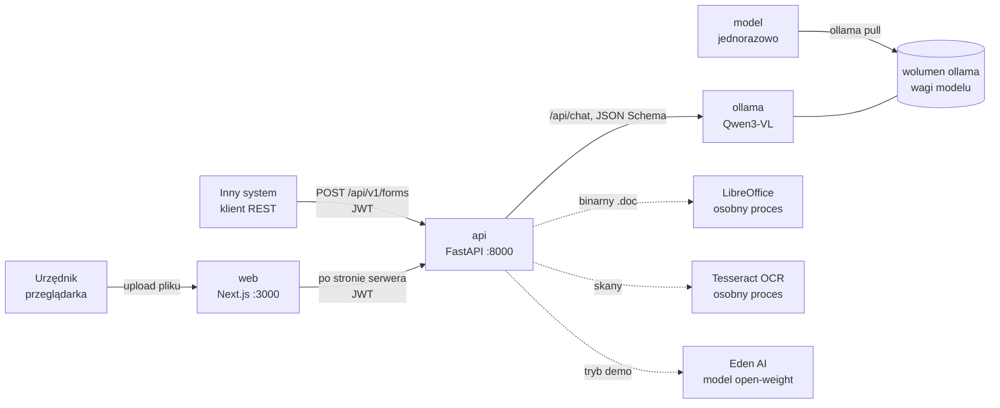

# Architektura rozwiązania autoformularz

Dokumentacja architektury wymagana w treści zadania (3.2.II, „Wymagania techniczne”). Opisuje komponenty,
przepływ danych, kontrakty, bezpieczeństwo, wdrożenie z kosztami i licencje. Szczegóły kroków przetwarzania:
[pipeline.md](pipeline.md), decyzje projektowe: [decisions.md](decisions.md).

## 1. Cel

Urzędnik przesyła jeden plik z formularzem papierowym (PDF, DOC, DOCX, ODS, XLSX, JPG, JPEG, PNG). Usługa
REST zwraca JSON konfiguracji e-formularza w formacie importu COI (jak wzorce w `materialy/1.*` i `materialy/5.*`),
zgodny ze standardem projektowania formularzy i regułami technicznymi.

Całość działa lokalnie: model językowy jest uruchamiany w kontenerze (Ollama), bez zewnętrznych API, MCP i SaaS.

## 2. Komponenty



| Usługa (`docker-compose.yml`) | Obraz | Rola | Port |
|---|---|---|---|
| `api` | `python:3.14.10-slim-trixie` + nasz kod | REST API, cała logika konwersji | 8000 |
| `ollama` | `ollama/ollama:0.40.17` | serwer modelu (CPU lub GPU) | tylko w sieci Dockera |
| `model` | `ollama/ollama:0.40.17` | jednorazowe pobranie modelu do wolumenu, potem kończy pracę | brak |
| `web` | `node:22.23.5-alpine3.24` + Next.js | opcjonalny frontend: upload i podgląd JSON | 3000 |

Tryb demo (uzgodniony z mentorami COI): nakładka `docker-compose.eden.yml` wyłącza `ollama` i `model`, a `api` woła
model open-weight na Eden AI (`deepinfra/Qwen/Qwen3-VL-30B-A3B-Instruct`, odpowiednik lokalnego `qwen3-vl:30b`).
Koszt każdej odpowiedzi Eden trafia do `llm.EDEN_USAGE`, a suma od startu kontenera jest w `GET /health` (`usage`);
budżet zespołu: [eden-budzet.md](eden-budzet.md).

Kolejność startu jest wymuszona: `model` czeka, aż `ollama` odpowiada (healthcheck), a `api` startuje dopiero
po pobraniu modelu. Pierwsze żądanie nie trafia więc na brak modelu.

## 3. Przepływ żądania

Moduły w `api/src/autoformularz/`:

```
upload.py   nazwa (≤ 250 znaków, bez ; : > < / \ | ' * % $), rozmiar (konfigurowalny), MIME z zawartości
    ↓
extract.py  plik → Document: bloki tekstu z ID (b1, b2, …) w kolejności czytania + kandydaci na pola,
            OCR skanów (Tesseract + pol) do tych samych bloków i obrazy stron; .ods czytany wprost z XML,
            binarny .doc przez LibreOffice w katalogu tymczasowym
    ↓
llm.py      Document → FormSpec: model klasyfikuje i wskazuje bloki po ID, nie przepisuje tekstu;
            odpowiedź ograniczona JSON Schemą FormSpec, temperatura 0, jedna poprawka przy błędzie walidacji
    ↓
check.py    pokrycie: bloki bez odwołania, kandydaci bez pola, odwołania do nieistniejących bloków
    ↓
compiler.py FormSpec (+ Document) → JSON COI, deterministycznie: sekcje standardowe z szablonów, techNames,
            UUIDv5, walidatory, słowniki, dane inicjalne, warunki jsonata, przejścia; opcjonalnie pouczenia
            i podstawa prawna dosłownie z bloków (AUTOFORMULARZ_COPY_SOURCE_TEXT, domyślnie wyłączone)
    ↓
lint.py     reguły techniczne: strony, sekcje, typy pól, walidatory, słowniki, dane inicjalne, warunki
            (pole, opcja, cykle, kolejność), przejścia
    ↓
main.py     JSON do importu (nagłówki X-Autoformularz-Errors/-Warnings) albo ?details=true:
            form, spec, issues, notes, sourceFormat, document, coverage
```

### Dlaczego model wypełnia tylko FormSpec

Wynikowy JSON ma 1–2 tys. linii z UUID-ami i wyrażeniami jsonata. Mały lokalny model nie wygeneruje go
niezawodnie (ucięcia, duplikaty, błędne odwołania). Dlatego model wypełnia krótki, ograniczony schematem
FormSpec (strony tematyczne, pola, typy, warunki, odwołania do bloków), a resztę robi kod:

- **powtarzalność**: ten sam FormSpec daje ten sam JSON (ID z UUIDv5 z tytułu i techName),
- **zgodność ze standardem**: sekcje wspólne (urząd, wnioskodawca, adres, pełnomocnik, opłata skarbowa,
  kontakt, zgoda, podgląd) pochodzą z szablonów odwzorowujących wzorce COI,
- **wierność źródłu**: tekst prawny jest kopiowany z bloków, a nie przepisywany przez model,
- **testowalność**: kompilator i linter są pokryte testami porównującymi wynik ze wzorcami.

### Kontrakty między modułami

Opisane w [pipeline.md, „Kontrakt”](pipeline.md#kontrakt): `Document` (wynik odczytu), FormSpec (wynik modelu,
schemat pod `GET /api/v1/spec/schema`) i odpowiedź `?details=true` dla frontendu.

## 4. Bezpieczeństwo

| Wymaganie | Realizacja |
|---|---|
| Uwierzytelnianie | JWT HS256 (`Authorization: Bearer`), klucz `AUTOFORMULARZ_JWT_SECRET` tylko w zmiennej środowiskowej; wymagane `exp`, opcjonalnie `aud` |
| Walidacja pliku | tylko obsługiwane rozszerzenia, MIME sprawdzany z zawartości (magic bytes, struktura ZIP/OLE), nazwa i rozmiar jak w treści zadania |
| Przechowywanie | plik tylko w pamięci (OCR dostaje obraz przez stdin), a binarny .doc w katalogu tymczasowym usuwanym po żądaniu; brak bazy danych i zapisu plików |
| Sekrety | wyłącznie w runtime (`.env` czytany przez Compose); `.env*` w `.gitignore` i `.dockerignore`, nie trafiają do obrazów |
| Kontenery | oficjalne obrazy z przypiętą wersją, bez `latest`; `api` i `web` na użytkowniku bez uprawnień; na zewnątrz tylko porty 8000 i 3000 |
| Brak zewnętrznych usług | domyślnie model działa w kontenerze `ollama`, a `docker-compose.yml` wymusza `AUTOFORMULARZ_LLM_PROVIDER=ollama` i pusty klucz; Eden AI (modele open-weight) tylko tymczasowo, przez jawną nakładkę `docker-compose.eden.yml`, z kluczem wyłącznie w `api` |
| Frontend | token JWT nigdy nie trafia do przeglądarki: `web` woła API po stronie serwera |

Obraz `ollama/ollama` (dostawca zewnętrzny) działa jako root w swoim kontenerze. Nie wystawia portu na zewnątrz
i jest osiągalny tylko z sieci Dockera.

## 5. Wdrożenie i koszt

### Wymagania sprzętowe

Pomiar `docker compose up --build` od zera (bez cache obrazów i bez pobranego modelu): patrz sekcja
„Wymagania sprzętowe i czasy” w [README](../README.md#wymagania-sprzętowe-i-czasy).

### Platformy

Te same obrazy działają na Windows, macOS i Linuksie, na x86_64 i ARM64 (Apple Silicon): oficjalne obrazy
bazowe są wieloarchitekturowe, a skompilowane zależności (lxml, Pillow, pydantic-core, pypdfium2, sharp,
lightningcss, Tailwind, Next SWC) mają w plikach blokad wersje dla obu architektur. Pliki tekstowe mają końce
linii LF (`.gitattributes`), więc checkout na Windows nie zmienia tego, co trafia do obrazu.

### Koszt

- **Licencje**: zero. Wszystkie komponenty są open source, nic nie wymaga zakupu licencji komercyjnej.
- **Usługi zewnętrzne**: zero w wersji docelowej (Ollama). Tryb demo z Eden AI kosztuje ok. 0,005 USD za
  formularz (model `deepinfra/Qwen/Qwen3-VL-30B-A3B-Instruct`, [eden-budzet.md](eden-budzet.md)).
- **Sprzęt**: jeden serwer z Dockerem. Model 8B działa na CPU (wolniej) albo na GPU z co najmniej 8 GB VRAM
  (szybciej). Mniejszy model (np. `qwen3-vl:4b`, `qwen3-vl:2b`) to zmiana jednej zmiennej
  `AUTOFORMULARZ_LLM_MODEL`, bez zmian w kodzie, kosztem jakości.
- **Skalowanie**: `api` jest bezstanowe (bez bazy i plików), więc można uruchomić kilka instancji za
  load balancerem. Wąskim gardłem jest model: przepustowość rośnie z liczbą lub mocą GPU dla `ollama`.

### Wymiana modelu

Model to parametr konfiguracji. Każdy model wizyjny z Ollama z otwartymi wagami może zastąpić domyślny.
Kontrakt (JSON Schema FormSpec) się nie zmienia, a jakość sprawdzają te same testy i linter.

## 6. Zgodność z wymaganiami technicznymi

| Wymaganie z treści zadania | Gdzie |
|---|---|
| Python 3.14+ | `api/pyproject.toml` (`requires-python = ">=3.14"`), obraz `python:3.14.10` |
| REST API, jeden plik w żądaniu | `POST /api/v1/forms` (`multipart/form-data`, pole `file`) |
| Formaty PDF, DOC, DOCX, ODS, XLSX, JPG, JPEG, PNG | `upload.py`, `extract.py` |
| Walidacja MIME, nazwy, rozmiaru | `upload.py`, `AUTOFORMULARZ_MAX_UPLOAD_MB` |
| Pliki tylko w pamięci lub tymczasowo | `extract.py` (`tempfile.TemporaryDirectory` tylko dla LibreOffice) |
| Wynik: JSON do importu | odpowiedź `POST /api/v1/forms` bez `details` |
| Konfiguracja (rozmiar, JWT, integracje) | zmienne `AUTOFORMULARZ_*`, [README, „Konfiguracja”](../README.md#konfiguracja) |
| Docker: oficjalne obrazy, wersje, non-root, porty, sekrety w runtime | `api/Dockerfile`, `Dockerfile.web`, `docker-compose.yml` |
| README: budowanie, uruchomienie, konfiguracja, REST API | [README](../README.md) |
| Bez zewnętrznych API, MCP, SaaS i LLM tylko przez API | model w kontenerze `ollama`, sekcja 4 |
| Open source bez copyleft | sekcja 7 |

## 7. Licencje

Kod projektu: MIT. Zależności sprawdzone na zainstalowanych pakietach (`importlib.metadata`, `node_modules`).

### W działającym rozwiązaniu

| Komponent | Licencja | Jak używany |
|---|---|---|
| FastAPI, Pydantic, pydantic-settings, PyJWT, python-docx, openpyxl, annotated-types, anyio, h11, typing-inspection | MIT | biblioteki API |
| Uvicorn, Starlette, httpx, httpcore, idna, pypdf, lxml, click, python-dotenv | BSD-3-Clause | biblioteki API |
| python-multipart | Apache-2.0 | upload plików |
| pypdfium2 (z PDFium) | BSD-3-Clause / Apache-2.0 | renderowanie stron skanów PDF (zamiast PyMuPDF, który jest na AGPL) |
| Pillow | MIT-CMU (HPND) | zmniejszanie obrazów |
| typing_extensions | PSF-2.0 | biblioteka standardowa w backporcie |
| certifi | MPL-2.0 | zależność httpx (lista certyfikatów), używana bez zmian |
| Ollama | MIT | serwer modelu, osobny kontener |
| Qwen3-VL (`qwen3-vl:8b`) | Apache-2.0 | wagi modelu |
| LibreOffice 25.2.3 (pakiet Debiana 13 `libreoffice-writer-nogui`) | MPL-2.0 (od wersji 4.0; starsze 3.x były na LGPL-3.0) | osobny proces `soffice --headless` tylko do konwersji binarnego .doc, bez linkowania i bez zmian |
| Tesseract 5 + model `pol` (pakiety Debiana `tesseract-ocr`, `tesseract-ocr-pol`) | Apache-2.0 | osobny proces do OCR skanów |
| Next.js, React, motion, @base-ui/react, shadcn, tw-animate-css | MIT | frontend |
| lucide-react | ISC | ikony |
| class-variance-authority | Apache-2.0 | frontend |

### Tylko przy budowaniu i w developmencie

| Komponent | Licencja |
|---|---|
| uv, ruff, pytest, Biome, TypeScript, Tailwind CSS, lefthook | MIT / Apache-2.0 |
| lightningcss (przez Tailwind CSS) | MPL-2.0, tylko przy budowaniu CSS, nie trafia do obrazu |

### MPL-2.0 i LGPL: dlaczego to nie łamie zakazu copyleft

Treść zadania zakazuje licencji „wymagających upublicznienia całości lub części kodu” (np. AGPL, GNU GPL).

- **MPL-2.0** (LibreOffice, certifi, lightningcss) to copyleft na poziomie pliku: obowiązek udostępnienia dotyczy
  tylko zmienionych plików na MPL. Nie modyfikujemy ich, a LibreOffice uruchamiamy jako osobny program. Nasz kod
  nie musi być udostępniany. Mentorzy COI zastrzegli, że LibreOffice jest dopuszczalny tylko przy takiej
  licencji, dlatego .ods czytamy wprost z XML, a LibreOffice zostało tylko dla binarnego .doc.
- **LGPL-3.0**: pakiet `sharp` z biblioteką libvips (opcjonalna zależność Next.js do optymalizacji obrazów)
  **trafia do obrazu `web`** (sprawdzone: `node_modules/@img`, ok. 46 MB). LGPL pozwala na dynamiczne użycie
  bez udostępniania naszego kodu, ale to słaby copyleft, a `web` to tylko opcjonalny frontend. Do zrobienia
  po stronie frontendu: wyłączyć optymalizację obrazów (`images.unoptimized`) i nie kopiować `sharp` do obrazu.
- Nie przejrzeliśmy jeszcze licencji bibliotek systemowych Debiana, które instaluje pakiet LibreOffice.

## 8. Ograniczenia i dalsze kroki

- Skany: OCR daje bloki tekstu, ale puste kratki do zaznaczenia widzi tylko model na obrazie strony.
- Tryb demo z Eden AI zależy od internetu i budżetu zespołu; wersja docelowa (Ollama) działa bez sieci.
- Czasy odpowiedzi modelu w Dockerze nie są jeszcze zmierzone (patrz README).
- `/api/v1/forms/compile` nie dostaje dokumentu źródłowego, więc po ręcznej korekcie FormSpec pouczenia
  i podstawa prawna nie są dołączane.
- Czas odpowiedzi na samym CPU jest liczony w minutach; do pracy na wielu formularzach zalecany GPU.
